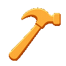

 

  
  &nbsp;&nbsp;&nbsp;&nbsp;
  
  &nbsp;&nbsp;&nbsp;&nbsp;
  

<h2> My Favorite Tools</h2>

### 💻 Languages & Runtimes

  
  
  
  
  
  
  
  
  
  
  
  
  
  
  
  
  
  

### 🧩 Frameworks & Game Engines

  
  
  
  
  
  
  
  
  
  
  
  
  
  
  
  
  

### ☁️ Cloud, Databases & DevOps

  
  
  
  
  
  
  
  
  
  
  
  
  
  
  

### 🎨 Development & Design Tools

  
  
  
  
  
  
  
  

## Contact 📫

You can reach me via any of my emails:

