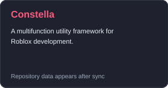
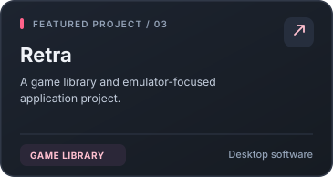
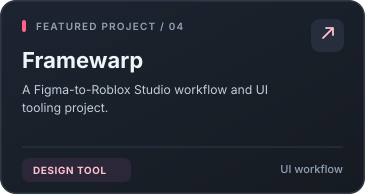

<!--
  Zense profile README — self-hosted SVG cards that do not rely on Vercel stats endpoints.
  Upload this README.md and the entire assets/, scripts/, and .github/ folders.
  Replace YOUR_GITHUB_USERNAME, YOUR_DISCORD_URL, YOUR_LINKEDIN_URL below.
  Discord username: @zensyi. A direct user profile link needs your numeric Discord user ID.
  Once uploaded to your profile repository, run the workflow
  Actions > Update profile cards and stats > Run workflow.
  This refreshes cards with real public repo stats and a GitHub contribution chart.
-->

# Zense

<strong>Software Developer &nbsp;·&nbsp; Game Developer &nbsp;·&nbsp; Open-Source Creator</strong>

<em>Always learning new things</em>

  
  &#8287;&#8287;&#8287;&#8287;&#8287;
  
  &#8287;&#8287;&#8287;&#8287;&#8287;
  

Discord: <strong>@zensyi</strong>

<h2>📘 My Top Open Source Projects</h2>

<!-- Repo cards are stored in this repository, so they will not break when an external image API is down. -->

  
  
   
  
  

  

<h2>🛠️ My Favorite Tools</h2>

### 👨‍💻 Programming and Markup Languages

  
  
  
  
  
  
  
  
  
  

### 🌐 Frontend Development

  
  
  
  
  

### 📱 Mobile Development

  
  

### ⚙️ Backend and Runtime

  

### ☁️ Cloud and Hosting

  
  
  
  
  
  
  

### 🔧 DevOps and Automation

  
  
  
  

### 🎮 Game Development

  
  
  
  

### 🧰 Software and Design Tools

  
  
  
  
  
  
  

### 🗄️ Databases

  
  

<h2>📊 Stats and Activity</h2>

### 💻 GitHub Profile Stats

### ⚡ Recent GitHub Activity

---

<strong>Thanks for visiting my profile!</strong>

