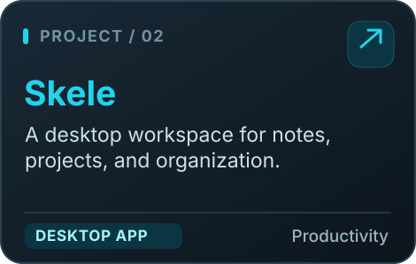
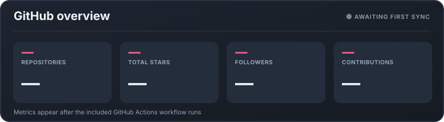
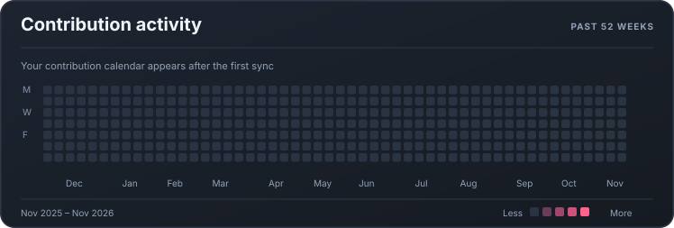

<!--
  Zense profile README — self-hosted SVG cards that do not rely on Vercel stats endpoints.
  Upload this README.md and the entire assets/, scripts/, and .github/ folders.
  Replace YOUR_GITHUB_USERNAME, YOUR_DISCORD_URL, YOUR_LINKEDIN_URL below.
  Discord username: @zensyi. A direct user profile link needs your numeric Discord user ID.
  Once uploaded to your profile repository, run the workflow
  Actions > Update profile cards and stats > Run workflow.
  This refreshes cards with real public repo stats and a GitHub contribution chart.
-->

# Zense

<strong>Software Developer &nbsp;·&nbsp; Game Developer &nbsp;·&nbsp; Open-Source Creator</strong>

<em>Always learning new things</em>

  
  &#8287;&#8287;&#8287;&#8287;&#8287;
  
  &#8287;&#8287;&#8287;&#8287;&#8287;
  

Discord: <strong>@zensyi</strong>

<h2>📘 My Top Open Source Projects</h2>

<!-- Repo cards are stored in this repository, so they will not break when an external image API is down. -->

  
  
  
  

<a href="https://github.com/YOUR_GITHUB_USERNAME?tab=repositories"><strong>▣ CLICK HERE FOR ALL MY REPOS</strong></a>

<h2>🛠️ My Favorite Tools</h2>

### 👨‍💻 Programming and Markup Languages

### 🌐 Web, Mobile, Cloud and DevOps

| Category | Technologies |
| :--- | :--- |
| **Frontend** |      |
| **Mobile** |   |
| **Languages & Runtime** |     |
| **Cloud & Hosting** |        |
| **DevOps** |    |

### 🎮 Game Development

### 🧰 Software and Design Tools

### 🗄️ Databases and Platforms

<h2>📊 Stats and Activity</h2>

### 💻 GitHub Profile Stats

### ⚡ Recent GitHub Activity

---

<strong>Thanks for visiting my profile!</strong>

